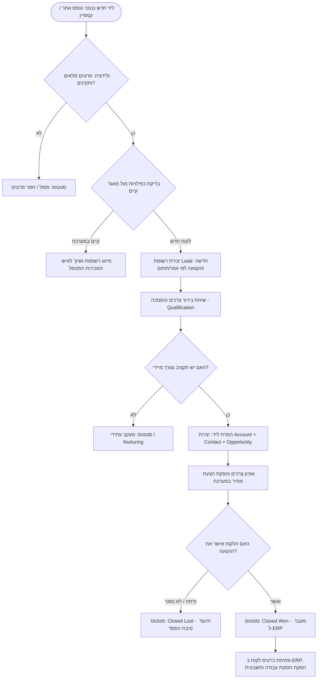

# B2B Lead-to-Order Business Process Flow

## Overview
This flowchart defines the standard B2B lifecycle from multi-channel lead ingestion, qualification, deduplication, opportunity management, through to ERP invoice and order creation.

## Process Flowchart

